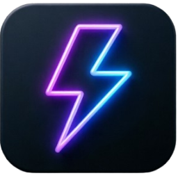

  

  # ZAPFIT Mobile (fork Endurain)

  
  
  **Продвинутое мобильное приложение для фитнеса и хайкинга**  
  *Базируется на проекте Endurain, дополнено премиальными функциями и глубокой интеграцией с Android.*

  

    <i>Кроссплатформенное приложение для iOS, Android и macOS</i>
  

## О проекте ZAPFIT

ZAPFIT — это мощный форк [Endurain Mobile](https://github.com/endurain-project/endurain-flutter), созданный для обеспечения более нативного и премиального пользовательского опыта. Мы сфокусировались на красивой визуализации данных, умных голосовых подсказках и современной эстетике Material You.

## Новые возможности ZAPFIT

🚀 **Эксклюзивные доработки:**

- **Модуль "Здоровье" (NEW):**
    - **Дашборд:** Ежедневная сводка всех показателей на одном экране.
    - **Трекер веса:** Интерактивные графики динамики и расчет ИМТ.
    - **Мониторинг сна:** Анализ фаз сна (глубокий, легкий, REM) и оценка качества.
    - **Контроль гидратации:** Быстрое добавление выпитой воды с наглядным прогрессом цели.
    - **Шагомер:** История активности и цели на день.
    - **Умная синхронизация:** Двусторонняя синхронизация с сервером (Pull/Push) с индикацией прогресса в реальном времени и полным офлайн-режимом.
- **Dynamic Color (Android 12+):** Автоматическая адаптация под обои смартфона.
- **Градиентные графики:** Красивая визуализация темпа и пульса.
- **Голосовой умный тренер:** Мотивация и подсказки во время тренировок.

✅ **Базовый функционал:**
- Безопасная авторизация и поддержка SSO.
- Запись треков и поддержка Bluetooth датчиков (BLE).
- Импорт и экспорт в формате GPX.
- Офлайн-кэширование карт.

## Технический стек

- **Framework:** Flutter 3.10+
- **State Management:** Provider
- **Визуализация:** [fl_chart](https://pub.dev/packages/fl_chart)
- **База данных:** SQLite (sqflite)
- **Голос:** [flutter_tts](https://pub.dev/packages/flutter_tts)

## Лицензия

Этот проект распространяется под лицензией AGPL-3.0.

---

  Сделано с ❤️ на базе Endurain | ZAPFIT — твой нативный фитнес-компаньон

